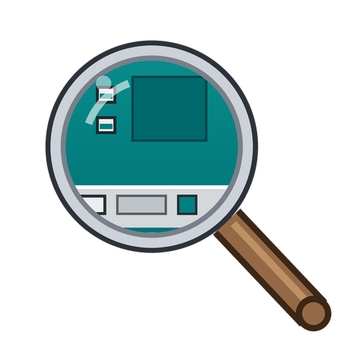

# RetroEye

**Bring back the Windows you grew up with.** RetroEye puts the taskbar, Start menu and system tray of Windows 95, 98, Me, 2000, XP, Vista and 7 back on today's Windows. It's free, and it's built in the open on YouTube, one episode at a time.

**[⬇ Download the latest version](https://github.com/RetroEye/RetroEye/releases/latest)** · **[💬 Forum: ideas, bugs, your desktops](https://github.com/orgs/RetroEye/discussions)** · **[📺 Watch it being built](https://www.youtube.com/@GoodEye-Studios)**

---

## Every version comes with an episode

Each release goes with a GoodEye episode. What you see in the video is what you get in the download, and every version stays available.

| Version | Episode | What's in it |
|---|---|---|
| [0.9](https://github.com/RetroEye/RetroEye/releases/tag/v0.9) | **E01:** [I Wanted an OS. I Fixed a Taskbar.](https://www.youtube.com/watch?v=Dwxp_VAhULk) | The taskbar, Start menus and system tray for every era, Solitaire, GoodEye Explorer and Navigator, and winipcfg |
| [0.10](https://github.com/RetroEye/RetroEye/releases/tag/v0.10) | **E02:** Naming RetroEye *(coming soon)* | GoodEye Messenger, GoodEye Player, the XP folder windows, Notepad, Paint, Calculator and the Command Prompt |

**More features to come.** Each new episode unlocks more of RetroEye, so watch the channel and check back here.

## What's in it so far

- **A taskbar from every era:** Windows 95, 98, Me, 2000, XP (Blue, Olive Green, Silver, Royale and more), Vista and 7.
- **Each era's own Start menu:** the classic cascading menu, XP's two-column menu, and Vista's and 7's with search.
- **Era presets** that set the theme, the Start menu and the desktop colour together.
- **The system tray as it was**, with a network icon in each era's style.
- **Solitaire**, dealt the way you remember.
- **GoodEye Explorer and GoodEye Navigator**, browsers in the style of the late-90s ones.
- **winipcfg**. We know it doesn't belong in a Windows XP look. It's in there because we like it.
- **New in 0.10:** GoodEye Messenger, GoodEye Player, the XP folder windows, and Notepad, Paint, Calculator and the Command Prompt in each era's style.

## Install

1. Download the **Setup.exe** from the [latest release](https://github.com/RetroEye/RetroEye/releases/latest).
2. Run it. If it's needed, Setup downloads Microsoft's .NET Desktop Runtime for you.
3. **"Windows protected your PC"?** RetroEye isn't code-signed yet, so Windows doesn't recognize it. Click **More info**, then **Run anyway**.
4. **Blocked with no Run anyway button?** That's Smart App Control, which is on for some brand-new Windows 11 PCs. It blocks programs that aren't code-signed, and RetroEye isn't signed yet. **We plan to sign it soon (hopefully!)**, and then it'll install there too.

RetroEye installs just for you, with no admin rights needed. You can remove it from **Settings > Apps** like any other program.

**Needs:** Windows 10 or 11 (64-bit, 32-bit or ARM), or Windows 7 SP1 or 8.1.

## Ideas, bugs and your desktops

The **[forum](https://github.com/orgs/RetroEye/discussions)** is where you can:
- ask for a feature;
- report a bug;
- show off your desktop.

Bugs found on camera get fixed on camera, and good ideas end up in episodes.

## Credits

- RetroEye is made by **GoodEye Studios**. The GoodEye logo art is by [@Casify24](https://www.youtube.com/@Casify24).
- RetroEye is built on [RetroBar](https://github.com/dremin/RetroBar) by Sam Johnson and contributors, and on [ManagedShell](https://github.com/cairoshell/ManagedShell). Both are under the Apache License 2.0, and their licence and notices come with every download.
- The source code isn't public yet.
- RetroEye is not affiliated with or endorsed by Microsoft. "Windows" is a trademark of Microsoft Corporation. RetroEye's themes recreate past looks with their own artwork.
